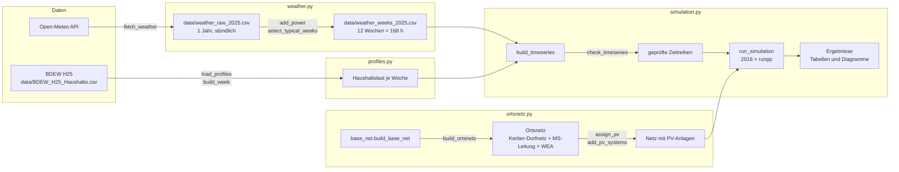

# Task 2 – Schaltgeräte, Stufenschalter und saisonale Ortsnetzprofile

Dieses Verzeichnis enthält das Notebook `Task2.ipynb` und die ausgelagerten Python-Module für die saisonale Simulation eines Niederspannungs-Ortsnetzes mit Haushalten, PV-Anlagen und einer Windenergieanlage.

Die Kette besteht aus drei Stufen:

1. **Daten:** Lastprofile und Wetterdaten einlesen bzw. abrufen.
2. **Leistung:** Wetterdaten über Kennlinien in PV- und Windleistung umrechnen.
3. **Netz:** Zeitreihen an das Ortsnetz binden und für jede Stunde einen AC-Lastfluss rechnen.

---

## Überblick



---

## Dateien

| Datei | Inhalt |
|---|---|
| `Task2.ipynb` | Notebook mit allen Teilaufgaben, Texten, Ergebnissen und Quellen |
| `base_net.py` | Ausgangsnetz aus Task 1 (`build_base_net`) und Parametervariation (`vary_parameter`) |
| `profiles.py` | BDEW-Standardlastprofil H25: einlesen, Wochen bilden, dynamisieren, plotten |
| `weather.py` | Wetterabruf (Open-Meteo), Umrechnung in PV- und Windleistung, Auswahl typischer Wochen |
| `ortsnetz.py` | Aufbau des Ortsnetzes (Kerber-Dorfnetz an Bus 2, MS-Leitung, WEA, PV-Anlagen) |
| `simulation.py` | Zeitreihen erzeugen und prüfen, zeitschrittweise Lastflussrechnung, Auswertung |
| `data/BDEW_H25_Haushalte.csv` | BDEW-Profil H25 (Haushalte), Original-CSV |
| `data/weather_raw_2025.csv` | Wetterdaten 2025, stündlich, UTC (wird von `weather.py` erzeugt) |
| `data/weather_weeks_2025.csv` | 12 typische Wochen mit PV- und Windleistung (wird von `weather.py` erzeugt) |

---

## Schnellstart

```bash
# Abhängigkeiten
pip install pandapower numpy pandas matplotlib networkx
pip install openmeteo-requests requests-cache retry-requests   # nur für den Wetterabruf

# 1. Wetterdaten abrufen und typische Wochen erzeugen (einmalig, benötigt Internet)
python weather.py

# 2. Notebook von oben nach unten ausführen
jupyter notebook Task2.ipynb
```

Sind die beiden Wetter-CSVs vorhanden, braucht das Notebook **keinen Internetzugang** und keine Open-Meteo-Bibliotheken. Alle Ergebnisse sind dann reproduzierbar. Fehlt `weather_weeks_2025.csv`, versucht das Notebook den Abruf selbst.

`numba` ist optional, beschleunigt die Lastflussrechnung aber deutlich.

---

## 1. Lastprofil (`profiles.py`)

### Eingangsdaten

Die BDEW-CSV enthält für 12 Monate × 3 Tagtypen je 96 Viertelstundenwerte in **kWh je Viertelstunde**, normiert auf **1 Mio. kWh Jahresverbrauch**. Die Datei ist in Windows-1252 kodiert, Trennzeichen `;`, Dezimalkomma.

Tagtypen: `WT` = Werktag, `SA` = Samstag, `FT` = Sonn- und Feiertag.

### Enums

```python
from profiles import Lastprofil, Month, DayType, Season

Lastprofil.HAUSHALT           # H25
Month.JULY                    # .number = 7, .label = "Juli"
DayType.WT                    # .value = "Werktag"
Season.SUMMER                 # .label = "Sommer", .months = (JUNE, JULY, AUGUST)
```

### Repräsentative Woche

`build_week()` setzt eine Woche aus **5 × WT, 1 × SA, 1 × FT** zusammen und rechnet sie in Leistung um:

| Schritt | Formel |
|---|---|
| Energie → mittlere Leistung | P = E / 0,25 h = 4 · E |
| Dynamisierung (Jahresgang) | P · F(t), t = Tag des Jahres |
| Skalierung auf den Jahresverbrauch | P · W_a / 1 000 000 kWh |
| Stundenwerte (optional) | Mittel der vier Viertelstunden |

Dynamisierungsfaktor nach BDEW (auf 4 Nachkommastellen gerundet):

F(t) = −3,92·10⁻¹⁰·t⁴ + 3,2·10⁻⁷·t³ − 7,02·10⁻⁵·t² + 2,1·10⁻³·t + 1,24

Er liegt zwischen etwa 0,79 (Sommer) und 1,26 (Winter).

```python
PROFILES = pr.load_profiles("data")
week = pr.build_week(PROFILES, Lastprofil.HAUSHALT, Month.JULY,
                     annual_kwh=3500,               # Jahresverbrauch
                     unit="MW",                     # "kW" oder "MW"
                     start=pd.Timestamp("2025-07-07"),  # Montag; Standard: erster Montag im Monat
                     resolution="1h")               # "15min" oder "1h"
```

Der Index ist ein echter Zeitstempel (Beginn des Intervalls). So passen Last- und Wetterwoche direkt zusammen.

### Plots

`plot_week`, `plot_day`, `plot_seasons`

---

## 2. Wetterdaten und Erzeugung (`weather.py`)

### Einstellungen (oben in der Datei)

| Konstante | Wert | Bedeutung |
|---|---|---|
| `LATITUDE`, `LONGITUDE` | 51,2 / 7,34 | Standort |
| `YEAR` | 2025 | Wetterjahr |
| `PV_TILT_DEG`, `PV_AZIMUTH_DEG` | 35° / 0° (Süd) | Modulneigung und Ausrichtung |
| `HOLIDAYS` | Feiertage NRW 2025 | Wochen mit Feiertag werden übersprungen |
| `PV_MODULE` | Trina Vertex S+ 460 W | P_STC, γ = −0,29 %/K, NOCT = 43 °C |
| `PV_SYSTEM_EFFICIENCY` | 0,86 | Systemverluste (Annahme) |
| `WIND_TURBINE` | Vestas V90-2.0 MW | Kennlinie, Nabenhöhe 105 m, Abschaltung 25 m/s |

### Ablauf von `python weather.py`

**1. Abruf: `fetch_weather()`**

Lädt ein ganzes Jahr stündlich über die Open-Meteo Historical Weather API:

| Variable | Einheit | Verwendung |
|---|---|---|
| `global_tilted_irradiance` | W/m² | Einstrahlung auf die Modulebene → PV |
| `temperature_2m` | °C | Zelltemperatur → PV |
| `wind_speed_100m` | m/s | Windgeschwindigkeit → Wind |
| `shortwave_radiation` | W/m² | nur zur Information |

Die Rohdaten werden in `data/weather_raw_2025.csv` gespeichert. **Existiert die Datei, wird nicht erneut abgerufen** (`force=True` erzwingt den Abruf).

**2. Zeitumrechnung: `to_local_hour_start()`**

- UTC wird in Europe/Berlin umgerechnet.
- Die Einstrahlung ist bei Open-Meteo das Mittel der *vorangegangenen* Stunde und wird deshalb um 1 h verschoben.
- Danach bezeichnet jeder Zeitstempel den **Beginn der Stunde**, genau wie beim Lastprofil.

**3. Leistung: `add_power()`**

*PV* (je Modul, AC):

```
T_Zelle = T_Luft + (NOCT − 20 °C) / 800 W/m² · G
P       = P_STC · G / 1000 W/m² · (1 + γ · (T_Zelle − 25 °C)) · η_System
```

Gespeichert werden `pv_module_w` (W je Modul) und `pv_kw_per_kwp` (kW je kWp).

*Wind*:

```
v_Nabe = v_100 · (h_Nabe / 100 m)^(1/7)          # Höhenprofil (Potenzgesetz)
P      = Kennlinie(v_Nabe), linear interpoliert   # 0 ab 25 m/s (Sturmabschaltung)
```

Gespeichert werden `wind_kw` (kW) und `wind_pu` (bezogen auf die Nennleistung).

**4. Typische Wochen: `select_typical_weeks()`**

- **Kandidaten:** alle Wochen Montag 00:00 bis Sonntag 23:00, die
  - vollständig im Monat liegen,
  - **keine Zeitumstellung** enthalten (168 Stunden),
  - **keinen Feiertag** enthalten (wegen der 5 Werktage im Lastprofil).
- **Auswahl:** je Monat die Woche, deren mittlere PV- und Windleistung zusammen am wenigsten vom Monatsmittel abweichen (Summe der relativen Abweichungen).
- `method="first"` wählt stattdessen die erste gültige Woche.

**5. Speichern: `build_weather_weeks()`**

Schreibt die 12 Wochen nach `data/weather_weeks_2025.csv`:

| Spalte | Einheit | Bedeutung |
|---|---|---|
| `time` | – | Beginn der Stunde, lokale Zeit |
| `month` | – | Name des Enums `Month`, z. B. `JULY` |
| `hour_of_week` | – | 0 … 167 (Mo 00:00 = 0) |
| `temperature_2m` | °C | Lufttemperatur |
| `global_tilted_irradiance` | W/m² | Einstrahlung auf die Modulebene |
| `wind_speed_100m`, `wind_speed_hub` | m/s | Wind in 100 m bzw. Nabenhöhe |
| `pv_module_w` | W | AC-Leistung je Modul |
| `pv_kw_per_kwp` | kW/kWp | AC-Leistung je kWp |
| `wind_kw` | kW | Leistung der V90 |
| `wind_pu` | – | Leistung / Nennleistung |

### Im Notebook

```python
WEATHER = wt.load_weather_weeks()                          # {Month: DataFrame mit 168 Zeilen}
WEEK_STARTS = {m: df.index[0] for m, df in WEATHER.items()}  # Montag jeder Wetterwoche
```

Plots: `plot_pv_curve`, `plot_wind_curve`, `plot_weather_week`, `plot_monthly_overview`

---

## 3. Ortsnetz (`ortsnetz.py`)

### `build_ortsnetz(with_mv_line=True, mv_line_km=5.0)`

Erweitert das Netz aus `base_net.build_base_net()`, **ohne dessen Topologie zu verwerfen**:

| Teil | Herkunft |
|---|---|
| externes Netz, Bus 1 (20 kV), Trafo 0,4 MVA 20/0,4 kV mit Stufenschalter, Bus 2, Leitung zu Bus 3 mit Last | bestehendes Netz (unverändert) |
| 6 Abgänge mit 57 Hausanschlüssen an Bus 2 | Niederspannungsteil des **Kerber-Dorfnetzes** (`pandapower.networks.create_kerber_dorfnetz`) |
| Bus „Bus 0 UW“, MS-Leitung NA2XS2Y 1x185 (5 km) nach Bus 1, WEA an Bus 1 | neu (nur mit `with_mv_line=True`) |
| je Leitung zwei Leistungsschalter (Anfang und Ende, geschlossen) | neu |

Kerbers 10-kV-Seite und sein Trafo werden nicht übernommen, seine NS-Sammelschiene wird durch Bus 2 ersetzt. Die Hausanschlusskabel wählt pandapower zufällig. Hier werden sie für reproduzierbare Ergebnisse **einheitlich als NAYY 4x50** angelegt.

**Rückgabe:** `net, idx, households`

- `idx`: Indizes wie bei `build_base_net`, ergänzt um `bus0`, `mv_line`, `wind`, `eval_bus`.
- `households`: DataFrame je Hausanschluss (Index = `load`) mit `bus`, `feeder` (Abgang), `position`, `name`, `distance_m` (Leitungslänge ab Bus 2).
- `eval_bus`: der Hausanschluss mit der größten Entfernung zum Trafo (Abgang 3, Haus 16, 495 m).

### PV-Anlagen

```python
has_pv = on.assign_pv(households, share=0.5)              # deterministisch, gleichmäßig je Abgang
pv = on.add_pv_systems(net, households, has_pv, kwp=10.12) # sgen am Bus des Haushalts
```

`pv` ist ein DataFrame je PV-Anlage (Index = `sgen`) mit `load`, `bus`, `feeder`, `kwp`.

---

## 4. Simulation (`simulation.py`)

### Zeitreihen (Aufgabe 3)

```python
TS = sim.build_timeseries(PROFILES, WEATHER, annual_kwh=3500, cos_phi_load=0.97)
```

Ergibt eine Tabelle mit 2016 Zeilen (12 Wochen × 168 h). Die Werte sind **normiert**:

| Spalte | Bedeutung |
|---|---|
| `p_hh_mw`, `q_hh_mvar` | Wirk- und Blindleistung **je Haushalt** (Q = P · tan(arccos cos φ)) |
| `pv_mw_per_kwp` | PV-Leistung **je kWp** |
| `wind_mw` | Leistung der Windenergieanlage |

Die Lastwoche wird auf dieselben Kalendertage gelegt wie die Wetterwoche.

| Funktion | Zweck |
|---|---|
| `element_table()` | Zuordnung Element → Bus → Profil → Skalierung |
| `check_timeseries()` | prüft Monate, Stunden, Lücken, Wochenbeginn, Vorzeichen und Zuordnung |
| `energy_summary()` | Wochenenergie von Last, PV, Wind und Residuallast |
| `plot_timeseries()` | Zeitreihen vor der Netzeinbindung |

### Lastflussrechnung (Aufgabe 4)

```python
RES = sim.run_simulation(net, idx, households, pv, TS, tap_pos=0)
```

Ablauf je Zeitschritt:

1. Leistungen setzen:
   - alle Haushalte: `load.p_mw = p_hh_mw`, `load.q_mvar = q_hh_mvar`
   - alle PV-Anlagen: `sgen.p_mw = pv_mw_per_kwp · kWp`
   - WEA: `sgen.p_mw = wind_mw`
2. `pp.runpp()` rechnen. Ab dem 2. Schritt mit dem Vorergebnis als Startwert (`init="results"`), was deutlich schneller ist.
3. Konvergenz prüfen:
   - Bei `LoadflowNotConverged` erhält der Zeitschritt `converged = False`, alle Ergebnisse bleiben leer (NaN).
   - Sonst werden die Ergebnisse gespeichert.

Das übergebene Netz wird vorher kopiert und nicht verändert.

**`tap_pos`:**

| Wert | Wirkung |
|---|---|
| `None` | Stufe des Netzes unverändert |
| `int` | feste Stufe |
| `{Month: int}` | Stufe je Monat (für Aufgabe 5) |

**Ergebnisspalten (eine Zeile je Zeitschritt):**

| Spalte | Bedeutung |
|---|---|
| `p_load_mw`, `p_pv_mw`, `p_wind_mw` | eingesetzte Leistungen (Summe) |
| `converged` | Lastfluss konvergiert |
| `vm_eval_pu` | Spannung am Auswertungsbus |
| `vm_bus1_pu`, `vm_bus2_pu` | Spannung an der Ortsnetzstation (MS- und NS-Seite) |
| `vm_lv_min_pu`, `bus_lv_min` | niedrigste NS-Spannung und Bus |
| `vm_lv_max_pu`, `bus_lv_max` | höchste NS-Spannung und Bus |
| `p_trafo_mw` | Wirkleistung auf der OS-Seite des Trafos (< 0 = Rückspeisung ins MS-Netz) |
| `loading_trafo_pct`, `loading_line_max_pct` | Auslastung Trafo / höchste Leitungsauslastung |
| `p_ext_grid_mw` | Leistung am externen Netz |

### Auswertung

| Funktion | Ausgabe |
|---|---|
| `summary_by_month()` | Extremwerte, Bandverletzungen, Stunden mit Rückspeisung, Auslastungen je Monat |
| `extreme_values()` | Zeitpunkte der niedrigsten/höchsten Spannung und der größten Rückspeisung bzw. des größten Bezugs |
| `plot_voltage_seasons()` | Spannung über die Woche je Jahreszeit mit Grenzen 0,9 / 1,1 pu |
| `plot_voltage_boxplot()` | Verteilung von min./max. NS-Spannung je Monat |
| `plot_trafo_power()` | Trafoleistung (Rückspeisung) und -auslastung |
| `plot_voltage_profile()` | Spannung entlang eines Abgangs zu einem Zeitpunkt |

---

## Vorzeichen und Einheiten

| Element | Konvention | P > 0 bedeutet |
|---|---|---|
| `load` | Verbraucherzählpfeilsystem | Bezug |
| `sgen` | Erzeugerzählpfeilsystem | Einspeisung |
| `res_trafo.p_hv_mw` | Leistung in den Trafo auf der OS-Seite | Fluss MS → NS; < 0: Rückspeisung |

Leistungen in pandapower in MW bzw. Mvar, Spannungen in pu, bezogen auf die Nennspannung des Busses. Zeitstempel in lokaler Zeit, Beginn der Stunde.

---

## Szenarien ändern

Alle Annahmen stehen im Notebook in der Zelle **3.1 Festlegungen**:

```python
ANNUAL_KWH   = 3500   # Jahresverbrauch je Haushalt [kWh/a]
COS_PHI_LOAD = 0.97   # Leistungsfaktor Haushalte
PV_SHARE     = 0.5    # Anteil Haushalte mit PV
PV_MODULES   = 22     # Module je Anlage (460 W) → 10,12 kWp
MV_LINE_KM   = 5.0    # Länge der MS-Leitung [km]
```

Standort, Jahr, Modulausrichtung und Anlagendaten werden in `weather.py` geändert. Danach `data/weather_*.csv` löschen und `python weather.py` erneut ausführen.

---

## Vereinfachungen und Grenzen

- **Standardlastprofil:** Es beschreibt den Mittelwert vieler Haushalte. Einzelne Lastspitzen fehlen.
- **Auflösung:** Stundenmittelwerte, kurzzeitige Schwankungen (Wolken, Böen) werden geglättet.
- **Lastfluss:** symmetrisch, keine Unsymmetrie durch einphasige Anlagen.
- **PV-Modell:**
  - kein bifazialer Mehrertrag, keine Verschattung
  - kein Schwachlichtverhalten, keine Wechselrichterbegrenzung
- **Wind-Modell:** keine Luftdichtekorrektur, keine Verfügbarkeitsverluste.
- **Blindleistung:** PV und Wind mit cos φ = 1, keine Blindleistungsregelung.
- **MS-Netz:** nur eine Leitung ohne weitere Stationen, externe Spannung fest 1,02 pu.

---

## Quellen (Auswahl)

Vollständige Angaben stehen im Notebook.

- BDEW, *Hinweise zu den aktualisierten Standardlastprofilen Strom*, Anwendungshilfe, 17.03.2025.
- P. Zippenfenig, *Open-Meteo.com Weather API*, Zenodo, 2023, doi: 10.5281/ZENODO.7970649.
- H. Hersbach et al., „The ERA5 global reanalysis“, *Q. J. R. Meteorol. Soc.*, 146(730), 2020.
- G. Kerber, *Aufnahmefähigkeit von Niederspannungsverteilnetzen für die Einspeisung aus Photovoltaikkleinanlagen*, Dissertation, TU München, 2011.
- L. Thurner et al., „pandapower – An Open-Source Python Tool …“, *IEEE Trans. Power Syst.*, 33(6), 2018.
- Trina Solar, Datenblatt Vertex S+ TSM-NEG9RC.27; wind-turbine-models.com, Vestas V90; windpowerlib (OEDB-Kennlinie V90/2000).
